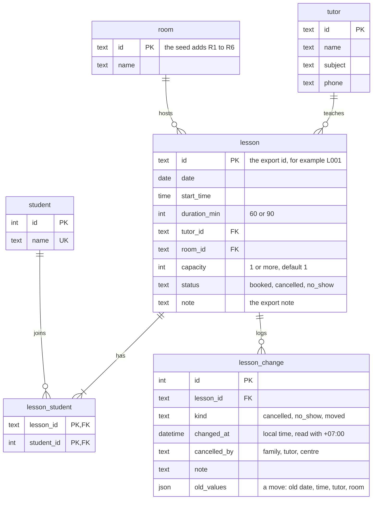

# Decisions

**Summary.** Bright Path is a tutoring centre that runs on a shared spreadsheet and WhatsApp. Its tutors learn about cancellations too late. I built one feature. A receptionist cancels a lesson or marks a no-show. Anyone can then open the schedule of a day and see what changed after it became final at 16:00 the day before. It runs on Python, FastAPI and SQLite. [README.md](README.md) has the commands. Phase 4 lists what is not built.

## 1. Reading the situation

### What hurts

- **Changes reach tutors too late.** A tutor drove in twice for lessons already called off. The receptionist fixes the spreadsheet the next morning, after the tutor has left. One cancellation in the export came 80 minutes before the lesson. A moved lesson overwrote the original, so its history is gone.
- **Double-booking.** The export has a student booked with two tutors at the same time, and a tutor booked in two rooms at the same time. The owner says the system must never allow this.
- **No quick view of today.** The owner wants to open the laptop and see today without scrolling.
- **The rules live in the receptionist's head.** She is the only person who understands the sheet, and she goes on leave in 8 weeks.

Only mentioned, not a pain: the size of the centre, pricing, WhatsApp, a waitlist, and tutor pay.

### Where the brief argues with itself

| Conflict | Reading I chose |
| --- | --- |
| The owner says the system must never allow a double-booking. The receptionist double-books exam pairs on purpose, and the families like it. | An exam pair is one lesson with two students. It is not a collision. |
| The owner wants the limit of 6 lessons a day for a tutor enforced. The receptionist breaks it when desperate. One tutor has 7 lessons on one day in the export. | The limit is a warning that saves a reason. |
| A late cancellation is charged in full and the tutor is paid. It also frees the room and the slot. | The family pays, and the slot is free. Question 4 asks the owner if it can be rebooked. |
| The schedule is final at 16:00 the day before. The receptionist also messages each tutor at 07:00 on the day. | A tutor is "told" at the 16:00 cut-off. |
| The centre is closed on Monday, but the export has one lesson on a Monday. | A lesson on a closed day is a warning, because exceptions happen. |
| The centre has 12 tutors and 6 rooms, so rooms should be scarce. The export has 3 tutors with one room each. | The export cannot show a room conflict. I did not model room scarcity. |
| The rules table has no rule for a student in two places, but this is the owner's first example. | It is a hard rule. |

### Questions for the owner

| # | Question | Effect of the answer |
| --- | --- | --- |
| 1 | Is an exam pair one lesson with two students? Who may set it up? | Yes: a lesson has a capacity and a list of students. No: a pair is an override of a normal collision. |
| 2 | Is the limit of 6 lessons a block, or a warning with a recorded reason? | Block: a database constraint. Warning: an override record that the owner can see. |
| 3 | What does "told" mean: the 16:00 cut-off or the 07:00 message? | Sets the point after which an edit shows as a change. |
| 4 | Who can cancel: the family, the tutor or the centre (storm, room closed)? Does a late cancellation free the slot? Is a family message after the start a late cancellation or a no-show? | Adds who cancelled and a note. Only a family cancellation with less than 4 hours of notice is charged. Decides which action the receptionist uses after the start. |
| 5 | What are the exact lesson hours? Which days is the centre closed, and does that change? Is a closed day closed without exception? | Closed weekdays are a setting. Yes: a lesson on a closed day is a block. No: it is a warning. |

Questions 1 to 4 go first. Until the owner answers, the assumptions below apply.

### Assumptions

- The receptionist reads and edits. The owner and the tutors only read. The tool does not send WhatsApp messages.
- Lessons last 60 or 90 minutes and run from 09:00 to 21:30. A student can learn any subject with any tutor.
- The centre is closed on Monday. The closed weekdays are a setting: a list of weekday names, for example `["monday", "sunday"]`.
- A lesson has a capacity: 1 for a normal lesson (the brief says one-to-one) and 2 for an exam pair. The schema accepts any capacity of 1 or more, but nothing checks that the students fit it.
- The export has no student ID, so the tool treats a student's name as unique.
- Hard rule: a student, a tutor or a room is never in two overlapping lessons.
- Warnings save a reason. They cover more than 6 lessons for a tutor in a day, and a lesson on a closed day or outside the hours. A pair counts as 1 lesson. A cancelled lesson does not count. A no-show does.
- A cancelled lesson occupies nothing. The receptionist can mark a no-show only after the start. Charging is out of scope.
- A cancellation records who cancelled (family, tutor or centre) and a note. A family cancellation with less than 4 hours of notice is late. Exactly 4 hours is free, because the brief says "free of charge up to 4 hours before". A cancellation after the start has negative notice, so it is late.
- A day's schedule is final at 16:00 on the previous open day. Tuesday's schedule is final on Sunday at 16:00, because Monday is closed.
- Times are Asia/Ho_Chi_Minh. The default "now" is 2026-03-06 07:00, a day inside the week of the export.
- The export contains two clashes: a student with two tutors at once, and a tutor in two rooms at once. They load as they are. The receptionist decides what is true, not the owner.

## 2. What to build

### Features this tool needs

1. Schedule: the lessons of one day, by tutor and room.
2. Cancellation: cancel a lesson or mark a no-show, with who and why.
3. Move: change the day or time of a lesson and keep the original.
4. Conflict checks: reject a student, tutor or room in two places.
5. Tutor limit warning: more than 6 lessons in a day, saved with a reason.
6. Waitlist: tell the next family when a slot opens.

### Pick: cancellation and the schedule

The schedule shows a cancellation or a no-show as a change when it happens after the 16:00 cut-off. The tutor and the owner see what changed without a message. A cancellation before the cut-off is stored, but the schedule leaves the lesson out, because the tutor never saw it. Anyone can view any day. A day is "draft" before its cut-off and "final" after it.

Why it comes first: it reaches all three roles.

- The schedule serves everyone. The owner wants to "see today, not scroll". The tutor wants one reliable message for the day. The receptionist builds that day by hand every morning.
- Cancellation is the shared pain of the tutor and the receptionist.
- The cancellation rules (late, no-show, who cancelled) live in the receptionist's head. The tool writes them down.

Why the rest wait:

- Move: the data model holds it, but there is no endpoint.
- Conflict checks: the tool cannot create a lesson, so it cannot create a conflict.
- Tutor limit warning: one day in the export breaks it.
- Waitlist: the export has no data on waiting families.

What I leave broken: nobody can book or move a lesson in the tool. The export is the only source of lessons. There are also no messages, no charging and no login.

## 3. Design

SQLite, FastAPI, Python and uv. Dates are `YYYY-MM-DD`. Times are `HH:MM` local time. A timestamp is ISO 8601 with the `+07:00` offset.

### Database



- `lesson` holds the current state only. A `booked` or `no_show` lesson occupies its room and slot. A `cancelled` lesson occupies nothing.
- An exam pair is one `lesson` with two `lesson_student` rows.
- `lesson_change` is an append-only log. The code never updates or deletes a row.

### A change after the tutor was told

The `lesson` row holds the current state. The `lesson_change` row holds what happened and when. A move saves the old date, time, tutor and room in `old_values`, so the original survives. The spreadsheet lost it.

The schedule decides what "after the tutor was told" means. It compares `changed_at` with the cut-off of the lesson's day. The database stores no flag for it.

### Where each rule lives

| Rule | Where | Why |
| --- | --- | --- |
| Duration is 60 or 90. Capacity is 1 or more. Status, kind and `cancelled_by` have fixed values. `cancelled_by` only on a cancellation. At most one cancellation or no-show for each lesson. A lesson has a real tutor and room. | Database | These checks are cheap. Nobody overrides them. |
| Draft or final. After the cut-off. Late cancellation. | Code, derived | A stored value goes stale. |
| No overlap for a student, tutor or room. More than 6 lessons for a tutor in a day. A lesson on a closed day or outside the hours. Students within capacity. | Not built | The tool cannot create or move a lesson. The receptionist can override some of them. |

When booking comes, the overlap rule goes in the database first, because the API and the seed both write.

### API

| Endpoint | What it does | Errors |
| --- | --- | --- |
| `GET /schedule/{date}?tutor_id=` | Returns the lessons of one day, with the state of the day, its cut-off, and the changes. `tutor_id` is optional. | 404 `tutor_not_found`, 422 `invalid_request` |
| `POST /lessons/{id}/cancel` | Cancels a booked lesson at any time. Body: `cancelled_by` (required), `note`. | 404 `lesson_not_found`, 409 `not_booked`, 422 `invalid_request` |
| `POST /lessons/{id}/no-show` | Marks a booked lesson as a no-show. It needs no body. | 404 `lesson_not_found`, 409 `not_booked`, 409 `lesson_not_started` |

Both `POST` requests run in one transaction. They set the status and add one change row, or they write nothing. They return the lesson. A cancelled or no-show lesson cannot change again.

An error returns `{"error": {"code": "...", "message": "..."}}`. An unknown path returns `not_found`, any other HTTP error returns `http_error`, and an unexpected failure returns `internal_error` with status 500.

The tool reads the current time from `BRIGHT_PATH_NOW` (default `2026-03-06T07:00:00+07:00`). `BRIGHT_PATH_DB` is the SQLite file (default `bright_path.db`).

How the schedule works:

- **Cut-off of a day:** 16:00 on the previous open day. It skips each closed day.
- **State:** `final` at or after the cut-off. Otherwise `draft`.
- **Lessons listed:** every `booked` and `no_show` lesson, and every `cancelled` lesson whose cancellation came after the cut-off. They are sorted by start time.
- **Late:** `true` for a family cancellation with less than 4 hours of notice. `null` for any other change.

```json
{
  "date": "2026-03-05",
  "state": "final",
  "cutoff": "2026-03-04T16:00:00+07:00",
  "lessons": [
    {
      "id": "L017",
      "start_time": "16:00",
      "end_time": "17:00",
      "tutor": {"id": "T3", "name": "Le Thu"},
      "room": "R3",
      "students": [{"id": 4, "name": "Do Van Kien"}],
      "status": "cancelled",
      "change": {
        "kind": "cancelled",
        "changed_at": "2026-03-05T14:40:00+07:00",
        "cancelled_by": null,
        "note": "tutor sick",
        "late": null
      }
    }
  ]
}
```

`change` is `null` for a lesson with no cancellation or no-show.

**Rejected: `DELETE /lessons/{id}`.** A delete erases what the tutor was told. This is how the spreadsheet lost the original of a moved lesson. A lesson is cancelled, never deleted.

Cancel and no-show are two endpoints because their rules differ. A cancellation can come at any time, needs `cancelled_by` and frees the room and slot. A no-show comes only after the start, has no `cancelled_by` and frees nothing.

### Seed

`uv run python -m scripts.seed` reads `data/`. It resets the database each time.

- The two export rows of an exam pair (same tutor, room and start, note "exam pair - half price") become one lesson with capacity 2.
- A cancelled row becomes a change row. Its time and note come from the export. `cancelled_by` stays empty. The export has no such column, and I do not guess it from the note.
- The export has no time for its one no-show. The change uses the start time of the lesson.
- Any other export note stays in `lesson.note`.
- The two clashes and the lesson on a Monday load as they are. The tool does not detect or flag them.

## 4. Reflection

### What I built and what I did not

I built cancellation, no-show and the schedule of a day. The data model has six tables with database rules, and a seed loads the export.

I did not build booking or moving a lesson, so the export is the only source of lessons. I also did not build the checks that need booking: no double-booking, the limit of lessons for a tutor, and closed days. There is no login, no message to tutors and no charging.

### Time spent

About 2 hours 10 minutes, from 09:00 to 11:11 on 2026-10-29. This is inside the limit of 2.5 hours.

### What I would build next

1. **Booking, with double-booking blocked in the database.** The owner says: "if the system allows it, the system is broken." Booking is the first feature that can create a clash. The rule goes in the database with it. The receptionist also needs a list of the clashes already in the data.
2. **Record when the family called.** Today the tool stores the time the receptionist types the cancellation. A family that calls at night and is entered the next morning looks like a short-notice cancellation. The late flag is then wrong.
3. **Show if the tutor saw a change.** The tool shows a change but cannot tell if the tutor read it. This is the main complaint of the tutors.
4. **Login with roles.** Only the receptionist edits.
5. **The two warnings:** too many lessons for a tutor in a day, and a lesson on a closed day.
6. **Moving a lesson.** The data model already holds a move.

### What I know is weak

Protection that is missing:

- There is no login. Anyone who can reach the API can cancel a lesson. The brief says only the receptionist edits, and the tool does not enforce it.
- Nothing stops or flags a double-booking. The sample data already contains two. They load as they are and show on the schedule without a warning.
- The tool marks a cancellation as late when the family gave less than 4 hours of notice, so staff can charge for it. It does not work out or record any charge.

Readings that the owner has not confirmed:

- A tutor counts as "told" at the 16:00 cut-off. The receptionist also messages tutors at 07:00 on the day.
- A family message after the lesson started is either a late cancellation or a no-show. The tool accepts both and has no rule.
- Two export rows with the same tutor, room and start time are one exam pair.

Limits of the data and the code:

- The time of a change is the time of entry, not the time the family called.
- The tool identifies a student by name. Two students with the same name would merge.
- The export has no time for a no-show and does not say who cancelled. I used the lesson start time for the first and left the second empty, because a guess would look like a real record. The late flag is therefore unknown for every cancellation in the sample data.
- A change made at exactly 16:00:00 does not show as a change, although the day is final at that moment.
- The tests check my reading of the rules, not the owner's. I checked the README steps by hand against the running server.

### Where the AI assistant helped

- **Analysis.** It read the brief and checked the sample data against every rule with a script. The script found the clashes, the overloaded tutor, the lesson on the closed day, and the cancellations close to the start.
- **Drafting and building.** It drafted this document, and it wrote the code and the tests.
- **Scope.** It proposed more than the scope needed, and I cut it back. I chose the feature and the rules, the names, and what to leave out. I also removed code and tests that this document did not require.

### A suggestion I threw away

The assistant proposed to enforce "no double-booking" in the database from the start. The sample data has two clashes, so the load would fail. To get past that, it also proposed a fourth status, "needs review", for the clashing records. I dropped both.

I was right for two reasons. First, the tool cannot create or move a lesson, so nothing that runs could break the rule, and the checks would guard nothing. Second, the extra status made a decision that is not ours. It set aside one record of each clash, but nobody knows which one is wrong. One may be a move that someone recorded as a new lesson. The other may be an exam pair that nobody labelled. The receptionist must decide. Now the data loads as it is, and the README lists the clashes.

The cost is that the data model allows the owner's own example until next step 1 is built.
